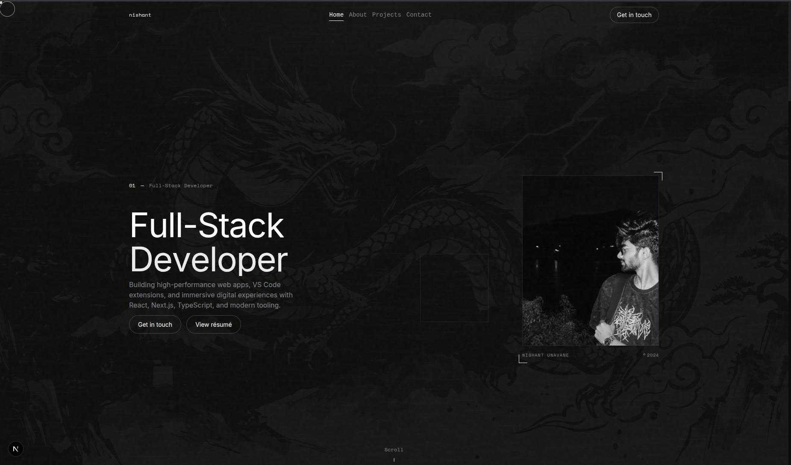

# Nishant Unavane — Full-Stack Developer Portfolio

<div align="center">
  
</div>

Welcome to the repository for my personal portfolio! This project showcases my work as a Full-Stack Developer, including my web applications, VS Code extensions, and open-source contributions. 

Built with a focus on modern aesthetics, blazing-fast performance, and rich interactive animations.

## 🚀 Live Demo
Visit the live site: [https://nishant-unavane.vercel.app](https://nishant-unavane.vercel.app)

## ✨ Key Features
- **Immersive GSAP Animations**: Smooth scrolling (Lenis), page transitions, stagger reveals, and interactive cursor effects.
- **Dynamic Projects Page**: Live fetches open-source repositories from the GitHub API, fully sortable and filterable.
- **Responsive Design**: Flawlessly optimized across mobile, tablet, and ultra-wide desktop screens using fluid typography (`clamp`) and Tailwind CSS grids.
- **SEO & Performance Optimized**: Server-Side Rendering (SSR) for the projects list, route-level metadata injection, and preloaded LCP assets for top Lighthouse scores.
- **Custom Audio Engine**: Try pulling the interactive Japanese Koto guitar strings on the homepage (built with the Web Audio API)!

## 🛠 Tech Stack
- **Framework**: [Next.js 15 (App Router)](https://nextjs.org/)
- **Language**: [TypeScript](https://www.typescriptlang.org/)
- **Styling**: [Tailwind CSS v4](https://tailwindcss.com/)
- **Animation**: [GSAP](https://gsap.com/) & [Framer Motion](https://www.framer.com/motion/)
- **Smooth Scroll**: [Lenis](https://lenis.darkroom.engineering/)
- **Icons**: [Lucide React](https://lucide.dev/)

## 💻 Running Locally

To run this project on your local machine, follow these steps:

1. **Clone the repository**:
   ```bash
   git clone https://github.com/IamNishant51/PORTFOLIO.git
   cd PORTFOLIO
   ```

2. **Install dependencies**:
   ```bash
   npm install
   # or yarn install / pnpm install
   ```

3. **Set up Environment Variables**:
   Create a `.env.local` file in the root directory and add any required keys (if integrating the contact form backend or GitHub API tokens).
   ```bash
   # Optional: For avoiding GitHub API rate limits on the Projects page
   GITHUB_TOKEN=your_personal_access_token_here
   ```

4. **Run the development server**:
   ```bash
   npm run dev
   ```

5. Open [http://localhost:3000](http://localhost:3000) in your browser to see the application running.

## 📝 License
Designed and developed by [Nishant Unavane](https://github.com/IamNishant51).
